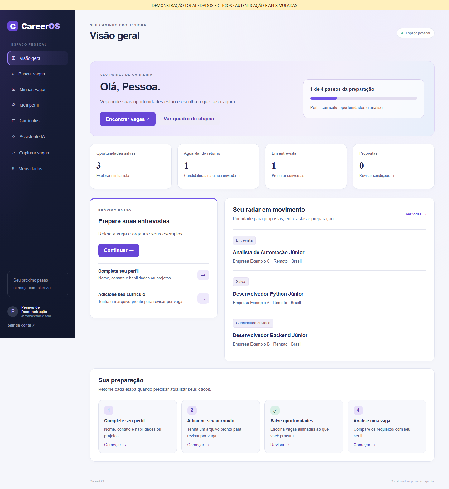
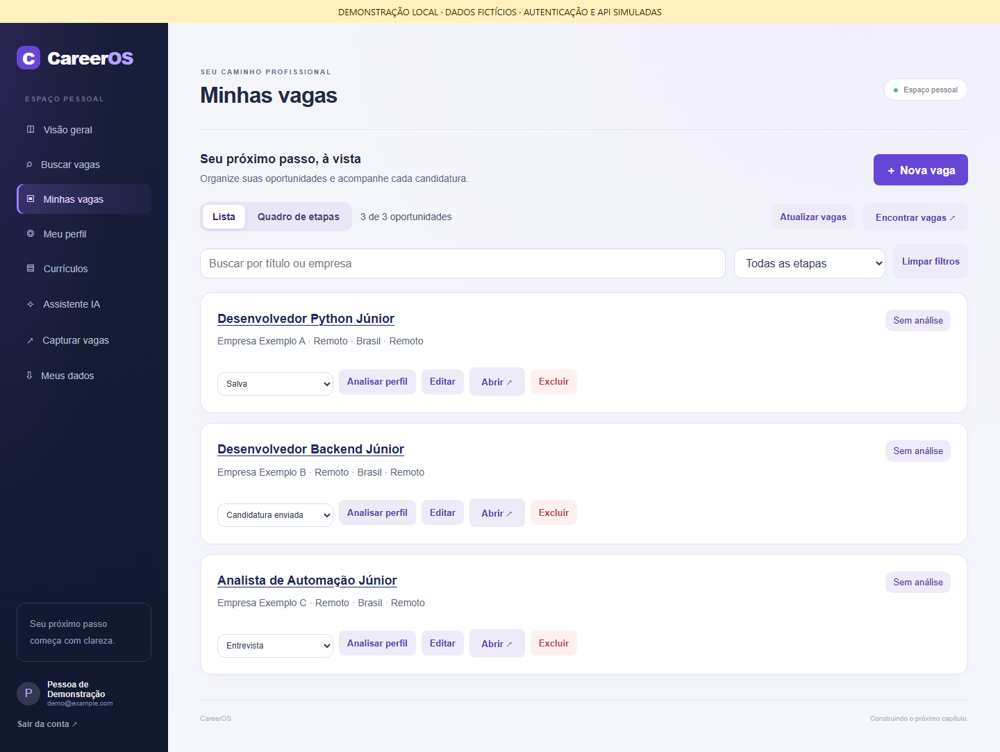
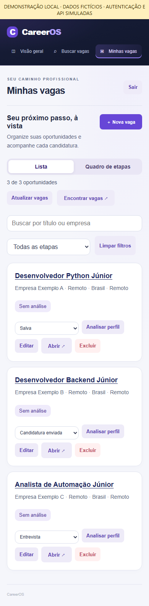

# Capturas de demonstração

Estas imagens usam a interface existente em `app/cloud/static/`, com uma pessoa
e três vagas fictícias. Cada imagem informa que a autenticação e as respostas
da API são simuladas. Não representam uma conta real ou a homologação do serviço
publicado, do Supabase Auth, do banco, de RLS, de Storage ou dos conectores de vagas.





<details><summary>Versão mobile</summary>



</details>

## Reproduzir

Na raiz do repositório, com Python 3.12+ e ambiente virtual:

```powershell
python -m pip install playwright
python -m playwright install chromium
python scripts/capture_portfolio.py
```

O script inicia um servidor temporário em `127.0.0.1`, em porta livre, que serve
os arquivos reais da interface. Um adaptador mínimo substitui o SDK somente
nesse servidor; as rotas de leitura retornam fixtures fixas. Não altera o código
da aplicação nem configura chaves. O navegador bloqueia requisições externas.

São verificadas a renderização do painel e da lista, as vagas esperadas e a
ausência de erros JavaScript. Capturas: desktop 1440 × 1050 e mobile 390 × 844,
com página completa e movimento reduzido. Os arquivos ficam em `docs/assets/`.
Essa verificação visual não cobre mutações, autenticação real ou busca externa.
